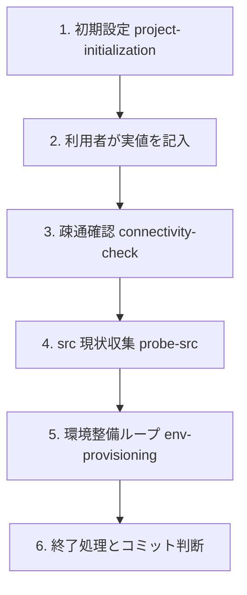

# 全体フロー（案件の開始から環境整備まで）

env_builder で「src を参考に dst の環境を整える」作業を、案件の開始から終了まで通して示す。
個々のコマンドは `scripts.md`、各手順の詳細は `skills/` を参照する。ここは**順序と分岐の地図**である。

## 全体像



| フェーズ          | 担当                                     | 入口                            | 主な成果物                                                                                  |
| ----------------- | ---------------------------------------- | ------------------------------- | ------------------------------------------------------------------------------------------- |
| 1. 初期設定       | エージェント（壁打ち）+ `init_config.py` | `skills/project-initialization` | `inventory/servers.json`、`build_env/set_env.bat`、`desired_state/git.json`（Git 案件のみ） |
| 2. 実値の記入     | **利用者**                               | 本書                            | 記入済みの設定・環境変数                                                                    |
| 3. 疎通確認       | エージェント                             | `skills/connectivity-check`     | 接続可否と切り分け結果                                                                      |
| 4. src 現状収集   | エージェント                             | `skills/probe-src`              | `build_env/` 配下の収集結果                                                                 |
| 5. 環境整備ループ | エージェント                             | `skills/env-provisioning`       | dst の環境、`build_env/logs/`                                                               |
| 6. 終了処理       | エージェント + 利用者                    | `rules/operation-safety.md`     | 一時領域の削除、コミット判断                                                                |

## 再開時の判定（セッションをまたぐとき）

初期設定の質問は、**未初期化の project に対して一度だけ**行う。別セッションで作業を再開するときは、
質問より先に、ファイルの存在から現在地を判定する。状態を別ファイルに持つと実態とずれるため、
判定は常に現物から導く。判定は読み取りだけで行い、`servers.json` や `set_env.bat` の中身は表示しない。

| 確認するもの                         | あれば                                                      | なければ                        |
| ------------------------------------ | ----------------------------------------------------------- | ------------------------------- |
| `projects/<id>/`                     | 既存 project。初期設定の壁打ちはしない                      | 未初期化。「1. 初期設定」を行う |
| `inventory/servers.json`             | 接続定義あり。プレースホルダ（`<...>`）が残っていれば未記入 | `init_config.py` の実行が必要   |
| `build_env/set_env.bat`              | 生成済み。記入済みかは読めないので利用者に1問で確認する     | 同上                            |
| `desired_state/git.json`             | Git 設定は確定済み。聞き直さない                            | Git 案件か1問だけ確認する       |
| `desired_state/*.json`               | 何を整備する案件かが分かる。内容を読んで把握する            | 必要な種類だけを質問する        |
| `build_env/logs/`                    | 過去の実行履歴あり。最新のログの成否を見て現在地を推定する  | 未実行                          |
| `projects/<id>/AGENTS.md` の「現状」 | 運用者が書いた最新の到達点。ログより優先して読む            | なし                            |

判定後の動きは次のとおり。

- **揃っている**: 検出結果を3行程度で報告し、「続きから何をするか」だけを尋ねる。
  例:「`neo-build`: 接続定義・desired_state あり。最後の build ログは anm221 で失敗（2026-09-30）。
  疎通確認から再開しますか、build の再実行ですか」
- **一部欠けている**: 欠けている項目だけを質問し、回答済みの項目は聞き直さない。
- **ほぼ空**: 「1. 初期設定」の壁打ちを行う。
- **判定できない**: 推測で進めず、利用者に確認する。

再開時の最初の実作業は、状態に応じて決める。迷う場合は「3. 疎通確認」から始める。環境変数が
読み込まれていないセッションでは接続に失敗するため、`call build_env\set_env.bat` を忘れていないかが
最初の切り分けになる。

### 現在地の記録

到達点は、各 project の `AGENTS.md` の「現状」節に、運用者またはエージェントが日付付きで残す。
`neo-build/AGENTS.md` がその例である。記録に含めるのは次のとおり。

- 何ができる状態か、誰がいつ確認したか（エージェントが再実行して確認していないことも明記する）。
- 最後に残っている失敗と、その原因。

秘密値、実ホスト名、絶対パスは書かない。

## 1. 初期設定

`project-initialization` が、案件ごとに変わる事項を**最初に質問**して確定する。
ただし、上記の判定で既存 project と分かった場合は行わない。
質問項目は SKILL.md の「壁打ちで要件を確定する」を参照する。要点は次のとおり。

- legacy 経路か、明示 project（`--project <id>`）か。
- 接続対象の役割（src / dst / bastion）と、root 定義（`dst_root` など）の要否。
- 認証方式と `password_env` の変数名（値は聞かない）。
- 必要な desired state（build / packages / files）。
- **Git 管理の有無**。該当する場合は `desired_state/git.json` を作る（後述）。

計画を提示し、利用者が「この内容で作成する」と明示した後だけ `init_config.py` を実行する。
初期設定だけで終了してよい。疎通確認以降は別の承認で進める。

### Git 設定（`desired_state/git.json`）

Git の扱いは案件ごとに異なるため、既定値は置かず、初期設定の質問で確定してから作る。
ファイルは Git 管理外の `desired_state/` に置く。**認証情報の値は書かない**（変数名だけ書く）。

```json
{
  "//": "認証情報の値は書かない。変数名だけを書く。",
  "repositories": [
    {
      "name": "example",
      "url": "https://git.example.invalid/group/repo.git",
      "dest_path": "/home/<user>/work/repo",
      "branch": "main",
      "server": "dst"
    }
  ],
  "auth": {
    "user_env": "ENVB_GIT_USER",
    "password_env": "ENVB_GIT_PASSWORD"
  },
  "identity": {
    "user_name": "<name>",
    "user_email": "<email>"
  },
  "name_resolution": {
    "needed": false,
    "note": "DNS または /etc/hosts の対応が必要な場合に理由を書く"
  }
}
```

- `identity` と `name_resolution` は必要な案件だけ書く。
- URL に認証情報（`user:pass@`）を含めない。
- 現時点でスクリプトはこのファイルを読まない。エージェントが読んで、`remote_exec.py` などの
  既存手段で実行内容を組み立てる。認証情報を dst へ渡す方法（コマンドラインに出さない方法）は
  未整備のため、Git 案件では実行前に方式を決めて利用者の承認を取る。
- `name_resolution` が必要な場合の `/etc/hosts` 変更は root 操作になる。ユーザー自身が実施する前提で案内する。

## 2. 利用者による実値の記入

エージェントは秘密値を受け取らない。利用者が次を行う。

1. `inventory/servers.json` に host、port、user、接続方式、`proxy_jump` を記入する。
2. `build_env/set_env.bat` に、`password_env` で指定した変数のパスワードを記入する
   （Git 案件は `ENVB_GIT_*` の `rem` を外して記入する）。
3. 実行するシェルで `call build_env\set_env.bat` を実行し、環境変数へ読み込む。
4. 必要な `desired_state/` を用意する。

既存の `set_env.bat` は `init_config.py` の `--force` では上書きされない。上書きは
`--force-credentials`（上書き前に `.bak` へ退避）で、別途承認を取って行う。

## 3. 疎通確認

`check_connectivity.py` で、踏み台越しに各サーバへ接続できるかを確認する。失敗した場合は
出力から、踏み台・認証・`proxy_jump` のどれが原因かを切り分け、記入内容を見直す。

## 4. src 現状収集

`probe_src.py` で src の OS、カーネル、パッケージ、リポジトリ設定を読み取る。src は参照専用
なので、状態を変える操作はしない。収集結果から dst との差分を見積もる。

## 5. 環境整備ループ

`env-provisioning` に従い、次を通るまで繰り返す。

1. 対象作業を実行する（`run_build.py` など）。
2. 失敗ログを読み、不足を特定する（`remote-investigation`）。
3. 不足に応じて整える（`apply_packages.py` / `sync_files.py` / `sync_tree.py`）。
4. 再実行する。

同じ対処を 2 回繰り返しても解決しない場合は、対症療法をやめて根本原因を診断する。
`run_build.py` は終了コードが 0 でも失敗していることがあるため、stderr のエラー痕跡も確認する。

## 6. 終了処理とコミット判断

- 作業用の一時領域（`/tmp/env_builder-<work-id>-XXXXXX/` とローカルの `build_env/work/<work-id>/`）が
  残っていないことを確認する。永続配置（`neo_app/src`、`lib` など）は削除対象ではない。
- timeout や中断があった場合は、リモートにプロセスが残っていないかを読み取りで確認する。
- 設定実体、認証情報、OSS、作業成果物はコミットしない。コミットするのは `.agent/`、
  `env_builder/`、`tests/`、`*.sample.*` などのツール本体だけである（`rules/git-workflow.md`）。

## 常時守ること

`rules/operation-safety.md` が正本である。要点だけ再掲する。

- sudo / su は使わない。root が要る操作は root 定義で直接ログインする。
- src は参照専用。root 定義での接続は、理由を示して確認を取った場合に限る。
- 破壊的・不可逆な操作は、影響を提示して応答を待つ。
- 秘密値を会話・コマンドライン・ログに出さない。
